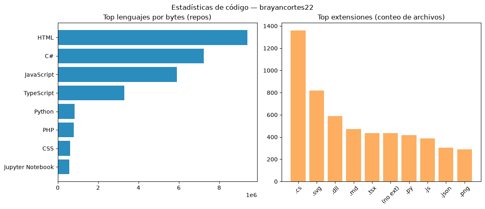

# BRAYAN STID CORTES LOMBANA

**Desarrollador Full-Stack, Arquitecto de Software & Sistemas de IA**  
*Ecosistema Microsoft (.NET 10, C#, Dynamics 365 F&O X++) | Java Empresarial (Java 21 LTS, Spring Boot 3.4) | DuckDB OLAP Columnar | Frontend React 19, TypeScript & Three.js 3D WebGL*

  
  
  
  
  
  
  
  

---

## 👨‍💻 Perfil Profesional

Desarrollador Full-Stack, Arquitecto de Software & Sistemas de IA especializado en el **ecosistema Microsoft (.NET 10, C#, Dynamics 365 F&O X++)**, **Java Empresarial (Java 21 LTS, Spring Boot 3.4.2)**, **procesamiento analítico de datos (DuckDB OLAP columnar embebido, Apache Parquet)** y **frontend moderno con gráficos 3D (React 19, TypeScript, Three.js / WebGL a 60 FPS)**.

Experiencia sólida en diseño de microservicios de alta concurrencia con transaccionalidad ACID y bloqueo pesimista `@Lock(PESSIMISTIC_WRITE)` anti-deadlock, Clean Architecture en 4 capas, desarrollo móvil nativo (**Android Kotlin con ML Kit On-Device y .NET MAUI**), orquestación de agentes de IA y blindaje **DevSecOps** (trampas invisibles Honeypot, Rate Limiting estricto anti-bots, criptografía PBKDF2/JWT y cumplimiento normativo de Habeas Data - Ley 1581 de 2012).

📍 **Ubicación:** Neiva, Huila, Colombia  
📞 **Teléfono / WhatsApp:** [+57 310 2944 906](https://wa.me/573102944906)  
✉️ **Correo:** [brayanstidcorteslombana@gmail.com](mailto:brayanstidcorteslombana@gmail.com)  

---

## 💼 Experiencia Profesional

### **Desarrollador Dynamics 365**
**Software Resources Factory S.A.S** | *2026 (6 meses)*
- **Personalizaciones & Extensiones:** Desarrollo de personalizaciones y extensiones para **Microsoft Dynamics 365 Finance & Operations** utilizando **X++**.
- **Lógica de Negocio & Formularios:** Modificación e implementación de clases de delegación, formularios de cotizaciones de ventas y reportes de órdenes de compra (SSRS) directamente en Visual Studio.
- **Entidades de Datos & Depuración:** Extensión de entidades de datos (`WHSShipmentSalesTableEntity` y tablas de staging) y depuración técnica de transacciones críticas de inventario (`PurchLine`, `InventTransId`).

---

## 🚀 Proyectos Destacados

### 🌍 [NASA Earth System Trend Detective — Observatorio Climático 3D & Motor Analítico](https://nasa-earth-trend-detective.vercel.app)
> **Despliegue en Vivo:** [nasa-earth-trend-detective.vercel.app](https://nasa-earth-trend-detective.vercel.app/) | **Organización:** [github.com/nasa-earth-detectives](https://github.com/nasa-earth-detectives/nasa-earth-trend-detective) | **Mirror Personal:** [github.com/brayancortes22/nasa-earth-trend-detective](https://github.com/brayancortes22/nasa-earth-trend-detective)  
> **Evento:** NASA International Space Apps Challenge 2026 | **Rol:** Frontend Lead & Full-Stack Architect

Plataforma científica global e interactiva para la detección, modelado y visualización de tendencias climáticas y anomalías terrestres a partir de datos satelitales oficiales de la NASA.
- **Observatorio 3D Inmersivo (GPU Accelerated):** Globo orbital interactivo a 60 FPS desarrollado con Three.js y Globe.gl, integrando cálculo astronómico en tiempo real del punto subsolar UTC, sombras de luz solar, textura de relieve terrestre y capas de contraste térmico.
- **Motor OLAP Columnar de Alto Rendimiento:** Backend en .NET 10 con DuckDB embebido y esquema analítico estrella (`fact_climate_observations`, dimensiones temporales y espaciales), ejecutando consultas y agregaciones Parquet sobre cientos de miles de registros en menos de 50 ms.
- **Pipeline ETL Satelital NASA:** Extractores y normalizadores de coordenadas a grilla canónica WGS84 para datasets satelitales (GISTEMP v4, MODIS NDVI, GRACE Mascon y OCO-2 XCO2), incorporando caché atómica en disco y resiliencia con Microsoft HTTP Resilience (Polly).
- **Gobernanza & DevOps Estricto:** Arquitectura Git Flow de 3 ramas (`development` ➔ `qa` ➔ `production`), Rulesets de protección contra force push, verificación automatizada de autoría limpia mediante GitHub Actions y despliegue continuo en Vercel Edge y Render.

---

### 🏦 Banking Core Transactional API — Ledger Financiero de Alta Concurrencia
> **Rol:** Arquitecto Backend & Ingeniero de Software | **Patrón:** Clean Architecture & Domain-Driven Design (DDD)

Motor transaccional bancario diseñado para procesar operaciones financieras masivas concurrentes con consistencia estricta ACID y garantía matemática contra condiciones de carrera.
- **Bloqueo Pesimista Anti-Doble Gasto:** Control de concurrencia a nivel de base de datos con `@Lock(LockModeType.PESSIMISTIC_WRITE)` en transacciones simultáneas de débito y crédito.
- **Ordenamiento Determinístico Anti-Deadlock:** Algoritmo de adquisición ordenada de bloqueos basado en `min(accountA, accountB)` que previene matemáticamente cualquier situación de interbloqueo (*deadlock*) en transferencias cruzadas de alta frecuencia.
- **Auditoría & Trazabilidad Inmutable:** Registro transaccional en doble partida contable (Ledger), manejo de DTOs inmutables, validación estricta de dominios y documentación viva interactiva con OpenAPI/Swagger.

---

### 🎵 [CarBeat — Jukebox de Cabina Automotriz WebGL & Visualizador Sonar Ya Dual](https://carbeat-pi.vercel.app)
> **Producción en Vivo:** [carbeat-pi.vercel.app](https://carbeat-pi.vercel.app) | **Versión:** 🟢 Prod v2.2.0 | **Rol:** Frontend Architect & Audio Engineer

Sistema de entretenimiento musical y visualización de cabina optimizado para pantallas táctiles y radios automotrices Android.
- **Fallback Híbrido 2D/3D & Resiliencia GPU:** Detección automática de hardware modesto (`deviceMemory <= 2GB` o prueba de compilación de shaders) con conmutación sin recarga a un modo Canvas 2D ultraligero, protegido por `ThreeErrorBoundary` para evitar cuelgues o reinicios en dispositivos embebidos.
- **Visualizador Sonar Ya Dual:** Análisis de frecuencias FFT en tiempo real con Web Audio API, animaciones por ondas sonoras reactivas sincronizadas con el espectro de graves y agudos.
- **Persistencia de Estado de Cabina:** Restauración instantánea de lista de reproducción, posición de pista y preferencias visuales en `localStorage` con arquitectura anti-fugas de memoria.

---

### 💎 [Accesorios Lilís — Plataforma Web Oficial & E-Commerce Artesanal](https://accesorios-lilis-2026.vercel.app)
> **Producción en Vivo:** [accesorios-lilis-2026.vercel.app](https://accesorios-lilis-2026.vercel.app) | **Repositorio:** [github.com/brayancortes22/accesorios-lilis](https://github.com/brayancortes22/accesorios-lilis) | **Rol:** Full-Stack Lead

Plataforma de comercio electrónico y catálogo interactivo creada para taller artesanal de bisutería en Algeciras (Huila).
- **Arquitectura Full-Stack:** Frontend desacoplado con React 19, TypeScript estricto, hooks personalizados (`useAuth`, `useCart`, `useProducts`) y API REST con ASP.NET Core y Entity Framework Core.
- **Seguridad & Autenticación:** Flujo de verificación de email en 2 pasos, hashing criptográfico PBKDF2-SHA256 (100.000 iteraciones), JWT Bearer tokens e integración oficial de **Google Identity Services (Google OAuth SSO)**.
- **Panel Administrativo a Pantalla Completa:** HashRouter (`#/admin/catalogo`, `pedidos`, `categorias`), `AdminGuard`, barra inferior móvil, tour interactivo guiado de 8 pasos con `driver.js` y enlace directo a WhatsApp.
- **SEO Estructurado:** Verificación en Google Search Console, microdatos Schema.org `JewelryStore` con geolocalización satelital y mapa interactivo oficial de Google Maps.

---

### 🎓 [Portal de Autogestión SENA — Plataforma Web & Móvil Integral](https://autogestion-sena.vercel.app)
> **Producción en Vivo:** [autogestion-sena.vercel.app](https://autogestion-sena.vercel.app) | **API & Swagger UI:** [autogestion-sena-api.onrender.com/swagger/](https://autogestion-sena-api.onrender.com/swagger/)  
> **Repositorios GitHub:** [Backend Web API](https://github.com/July173/Back-end-web-API-autogestionSena) · [Frontend Web](https://github.com/July173/autogestionFrontWeb) · [Frontend Móvil](https://github.com/July173/FrontMovilAutogestion)  
> **Rol:** Full-Stack Lead & Software Architect

Plataforma empresarial de autogestión académica y control de etapa productiva para el SENA, con soporte multiplataforma (Web y Móvil) y gestión en tiempo real.
- **Clean Architecture en 4 Capas (Backend):** Separación estricta en `Entities` (ORM relacional), `Repositories` (persistencia desacoplada), `Services` (reglas de negocio y transacciones atómicas) y `ViewSets` (entrega HTTP delgada con documentación en Swagger).
- **Asincronía con Celery & WebSockets:** Procesamiento en segundo plano con Redis y Celery Beat para tareas recurrentes programadas a medianoche, más alertas bidireccionales en tiempo real mediante Django Channels y Daphne ASGI.
- **ETL Streaming Sofia Plus:** Ingesta y normalización en streaming de planillas Excel (`.xlsx`) mediante `openpyxl` con validación fila por fila.
- **Cliente Móvil Multiplataforma (.NET MAUI):** Aplicación nativa en C# para Android y Windows con arquitectura espejo de consumo de API y autenticación institucional 2FA.

---

### 🛡️ Smart AI Router & BSCL Sec Sentinel — Pasarela de IA & DevSecOps
> **Rol:** Creador & Arquitecto | **Arquitectura:** Cascading AI Gateway & SAST Engine

Ecosistema de infraestructura local para orquestación de inteligencia artificial y auditoría de seguridad perimetral.
- **Cascada de Tolerancia a Fallos en IA:** Router OpenAI-compatible con redirección en cascada automática y sin fricción (Gemini ➔ Groq ➔ Cerebras ➔ OpenRouter `:free` ➔ Pollinations) que garantiza 100% de disponibilidad sin interrupción por límites de cuota.
- **Motor SAST Perimetral (Sec Sentinel):** Escaneo estático con 6 analizadores de código: detección de secretos en repositorios, inyecciones SQL/NoSQL, validación de trampas invisibles Honeypot, verificación de cabeceras seguras, criptografía moderna y cumplimiento normativo de privacidad de datos (Ley 1581 de 2012 Habeas Data / SIC).

---

### 🎮 Game Translator — Traductor Flotante en Pantalla para Android (On-Device & Offline ML)
> **Rol:** Diseñador y Desarrollador Android Nativo | **Arquitectura:** Foreground Service & MediaProjection

Herramienta nativa para Android de traducción de videojuegos móviles on-demand y en tiempo real, diseñada para jugadores de títulos MMORPG y Survival (LifeAfter, etc.) con textos en idiomas extranjeros.
- **Burbuja Flotante Overlay & Cero Interrupción:** Interfaz accesible en todo momento sobre la partida mediante Android `WindowManager` (`TYPE_APPLICATION_OVERLAY`) sin bloquear el juego ni salir de la app.
- **100% On-Device & Protección de Datos:** Procesamiento de OCR y traducción neuronal completamente local con Google ML Kit, garantizando cero consumo de datos móviles y privacidad absoluta.
- **Garantía Antiban (Seguridad de Proyección):** Captura no intrusiva a través de la API oficial de Android `MediaProjection`, sin manipular la memoria RAM ni inyectar código en los ejecutables del juego.

---

### ⚡ [TecniApp — Plataforma de Servicios Técnicos](https://tecniapp.netlify.app/)
> **Producción en Vivo:** [tecniapp.netlify.app](https://tecniapp.netlify.app/)

Aplicación web moderna orientada a la gestión y solicitud de servicios técnicos, enfocada en alta velocidad de carga, diseño responsivo y optimización de experiencia de usuario.

---

## 🛠️ Habilidades Técnicas

| Área | Tecnologías, Lenguajes y Herramientas |
| :--- | :--- |
| **Backend & Microservicios** | C# (.NET 10 / ASP.NET Core Web API), Java 21 LTS (Spring Boot 3.4.2), X++ (Dynamics 365 F&O), Python (Django 5 DRF, FastAPI), Node.js (Express), LINQ, Entity Framework Core, Spring Data JPA, Celery, Redis, Django Channels (WebSockets / Daphne), Polly (HTTP Resilience), PHP |
| **Bases de Datos & Motores OLAP** | DuckDB (Motor OLAP columnar embebido), Apache Parquet, PostgreSQL, MySQL 8.4 (Aiven Cloud), SQL Server, Redis, Modelado Relacional 3FN y Esquema Estrella |
| **Frontend & Gráficos 3D** | React 19, TypeScript, Three.js / Globe.gl (WebGL 3D 60 FPS), Canvas 2D nativo, Custom Hooks, JavaScript (ES6+), Vite, Tailwind CSS, Glassmorphism UI |
| **Móvil & Machine Learning** | Android Nativo (Kotlin), Google ML Kit (OCR & Traducción Neuronal On-Device 100% Offline), MediaProjection, Android MediaSession, .NET MAUI (C#) |
| **Arquitectura & Metodologías** | Clean Architecture en 4 capas (Entity-Repo-Service-ViewSet), Principios SOLID, Clean Code, Domain-Driven Design (DDD Simplificado), APIs RESTful, Action Classes, DTOs inmutables, Endpoint Facade |
| **DevSecOps & Blindaje Web** | Trampas invisibles Honeypot anti-bots, Rate Limiting perimétrico, Filtrado User-Agent de escáneres maliciosos, SAST, Prevención OWASP Top 10, Ley 1581 de 2012 (Habeas Data Colombia / SIC), JWT Bearer con Role Claims, PBKDF2-SHA256, 2FA TOTP, OAuth 2.0 (Google SSO) |
| **DevOps, Nube & CI/CD** | GitHub Actions (CI/CD Multi-Branch: `development` / `qa` / `main`), Docker, Vercel Edge / CLI, Render, Netlify, Azure DevOps, Git, Linux |
| **APIs, ETL & Servicios** | NASA EarthData API / CMR, Google Maps Platform, Google Search Console, openpyxl (Streaming Excel), OpenAPI / Swagger, Smart AI Router (Gateway Cascada OpenAI-Compatible) |

---

## 🎓 Educación

- **Tecnólogo en Análisis y Desarrollo de Software**  
  *SENA (Servicio Nacional de Aprendizaje) — Neiva, Colombia* | **2024 – 2026**
- **Técnico en Análisis y Desarrollo de Software**  
  *SENA — Algeciras, Huila, Colombia* | **2022 – 2023**
- **Bachiller Académico**  
  *Institución Educativa Juan XXIII — Algeciras, Huila, Colombia* | **2023**

---

## 🌐 Idiomas

- **Español:** Nativo
- **Inglés:** A2 (Lectura técnica y comprensión fluida de documentación oficial y especificaciones)

---

## 📊 Métricas de Código

---

## 📬 Contacto

¿Tienes un proyecto en mente o una propuesta laboral? Estaré encantado de conversar:

  
  
  

📍 Ubicación detallada

Neiva, Huila, Colombia

---
*Perfil actualizado y mantenido con control de versiones.*
